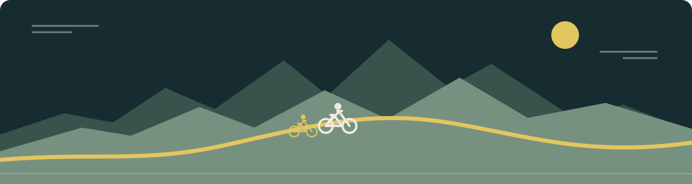
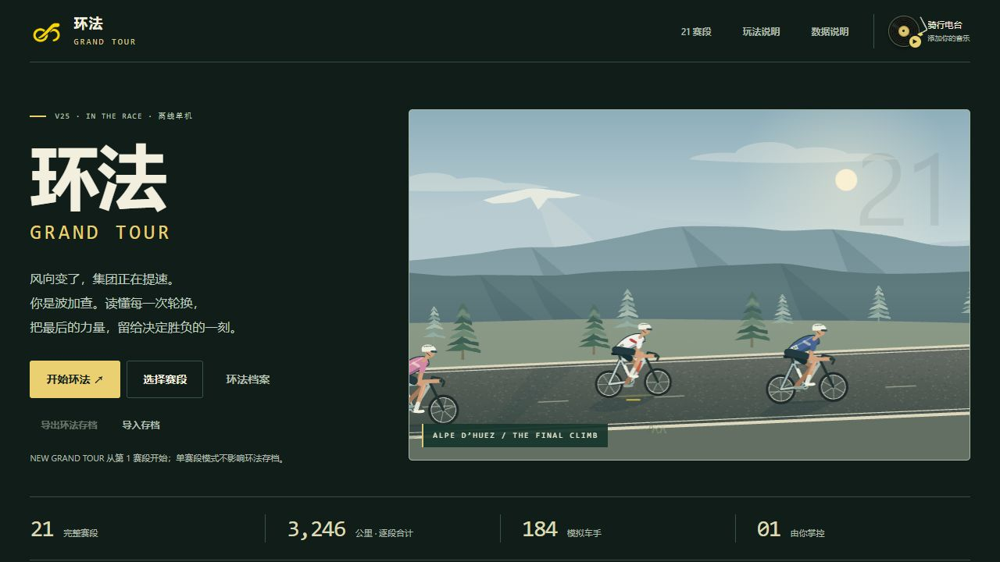
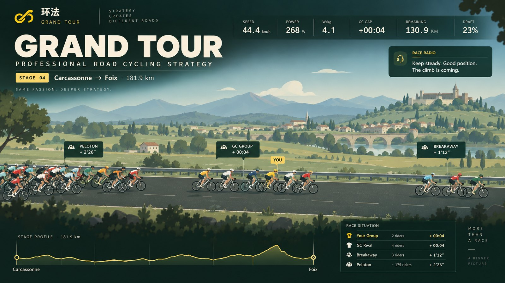

# Grand Tour

A playable road-cycling simulation where terrain, timing, fatigue, and the peloton shape a 21-stage tour.

[Play V25 online](https://seiya058904.github.io/Grand-Tour/) · [Open the standalone HTML](Grand-Tour-V25.html) · [How to race](#how-to-race)

The interface is in Chinese. V25 runs as one self-contained HTML file and needs no package installation to play.



*The current V25 interface in a local browser.*

## Inside the race

- **A complete stage race:** ride flat, hilly, mountain, individual time-trial, and team time-trial stages, with stage results and overall jersey standings.
- **A moving peloton:** groups form, split, chase, and set up leadouts. Rider roles and team objectives affect how they respond.
- **Effort and timing:** balance endurance and short bursts, follow other riders, attack, and choose when to recover or feed.
- **A changing route:** gradient, simulated weather, climbs, and descents influence the race and its presentation. Elevation profiles are simplified, not GPS replays.
- **Results that carry forward:** stage finishes feed the tour standings and presentation sequences; an in-progress tour can be saved and resumed locally.
- **Race information:** the Race Centre, rider details, route profile, team communications, and playback controls make the situation visible while riding.

## How to race

1. Start a tour or select a stage, then inspect its route and rider preparation.
2. Use the on-screen controls to adjust effort, follow a rider, attack, feed, or pause. The race canvas also exposes keyboard shortcuts in the in-game guide.
3. Watch the distance, terrain, energy, groups, and gaps. The demands of a mountain finish differ from a time trial or a sprint.
4. Finish the stage and review its results and jersey standings before continuing the tour.

The game is a simulation, not a record of actual weather or a replay of an official race. The V25 audit found a remaining flat-stage sprinter balance signal; see the [audit report](V25-AUDIT-REPORT.md) for its scope.

## Play locally

Download [`Grand-Tour-V25.html`](Grand-Tour-V25.html) as a raw file and open it in a modern browser. There is no build step or runtime network dependency. Alternatively, with Python installed, serve the repository locally:

```bash
python -m http.server 4187 --bind 127.0.0.1
```

Open <http://127.0.0.1:4187/>. File, local-server, and online origins may hold different browser saves. Export important progress before clearing browser data or changing where you play; local storage is not cloud synchronization.

## Model and continuity

The race advances with a fixed simulation step. Rider states, groups, timings, and classifications are calculated by the game rather than played as a prerecorded animation. V25 retains V9-format saves and historical-tour migration; its recovery behavior preserves the original bytes before a writable repair. Cross-process simultaneous writes without Web Locks are not guaranteed atomic.

V25 is the current entry; [`Grand-Tour-V24.html`](Grand-Tour-V24.html) and the earlier sources are retained comparison baselines. Historical evidence applies to the version and environment in which it was collected, rather than proving every current runtime combination.

## Verification and source

The game itself needs only a browser. The focused checks below require Node.js and Python; use an evidence directory outside the repository. Real-browser verification has additional Playwright and Chromium prerequisites.

```powershell
$evidence = Join-Path $env:TEMP 'grand-tour-check'
New-Item -ItemType Directory -Force $evidence | Out-Null
python tests/v25/static_verify.py --out "$evidence/static.json"
node tests/v25/core-parity.cjs Grand-Tour-V24.html Grand-Tour-V25.html "$evidence/core.json"
node tests/v25/focused.cjs Grand-Tour-V25.html archive/v22/Grand-Tour-V22.html "$evidence/focused.json"
node tests/v24/save-finish-boundary.cjs Grand-Tour-V25.html "$evidence/boundary.json"
```

The [verification and packaging guide](tests/v25/README.md) includes save validation, browser, full-tour, and source-package procedures. See also the [V25 audit](V25-AUDIT-REPORT.md), [changelog](V25-CHANGELOG.md), [presentation review](V25-PRESENTATION-20261024.md), [V24 report](V24-REPORT.md), [archive index](archive/README.md), and [repository guidance](AGENTS.md). The previous V24 final ZIP is intentionally absent from this handoff; the V25 source packager does not require it.

## Concept art

Concept art made for this project. It is an illustration, not a screenshot, and details may differ from the shipped interface.



## Rights

Grand Tour is an independent, unofficial cycling simulation. It is not affiliated with or endorsed by the Tour de France organizers, teams, or represented riders. No project-wide open-source license is declared; public source access is not blanket permission to redistribute the game or its artwork.
